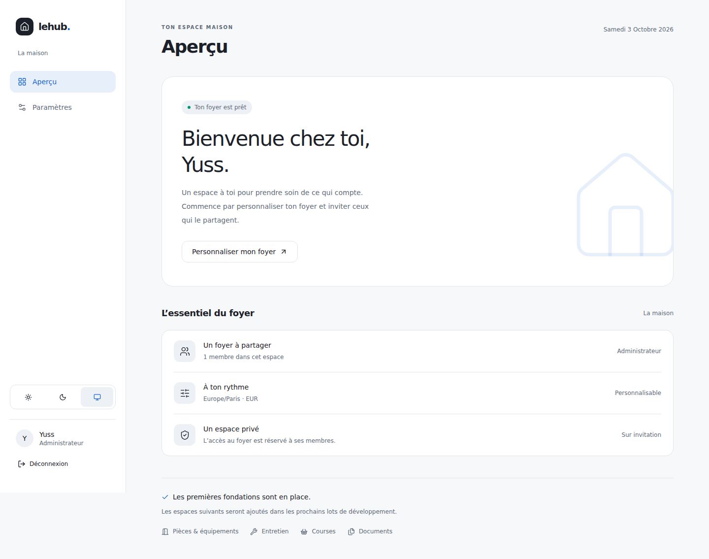
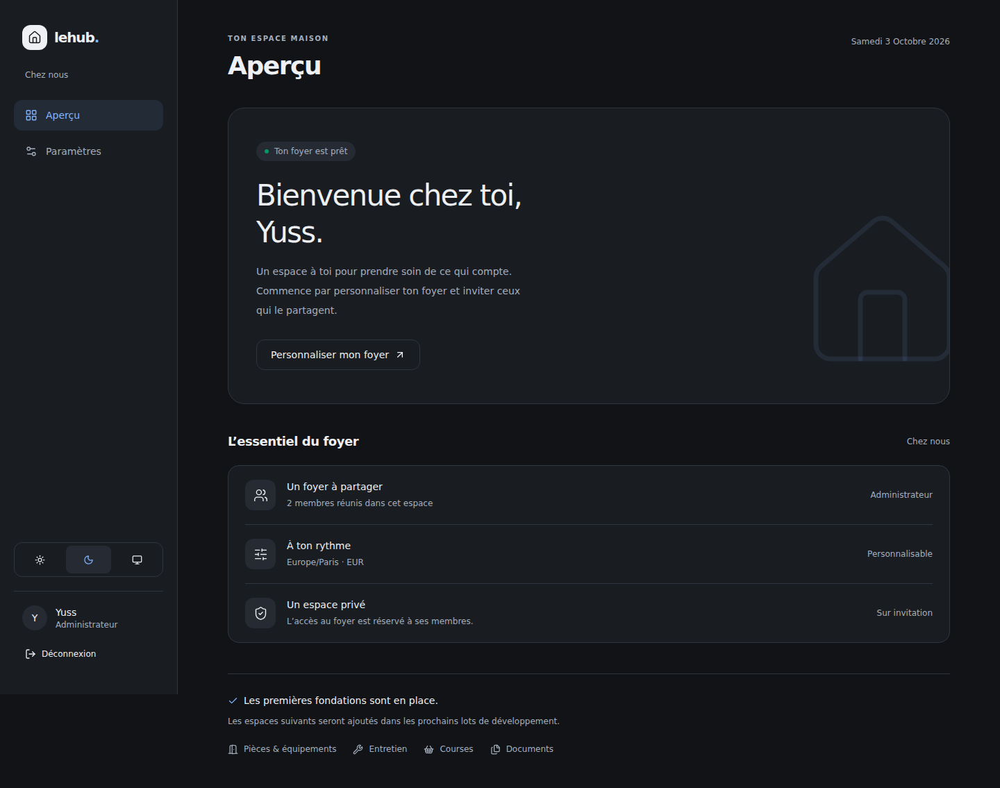
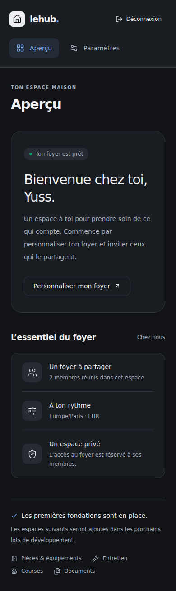
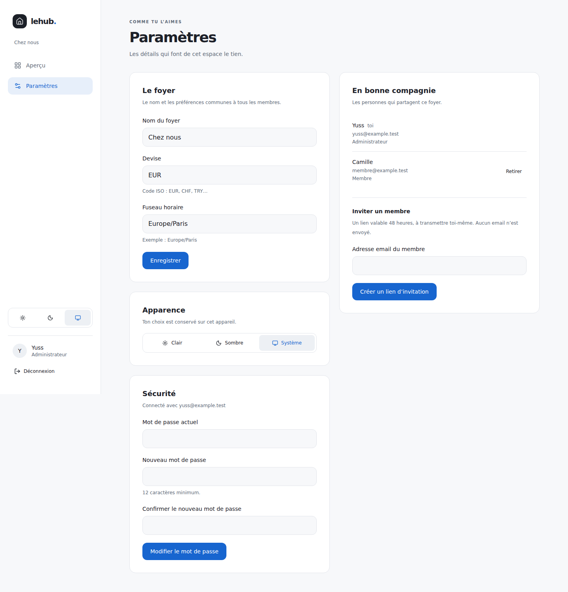
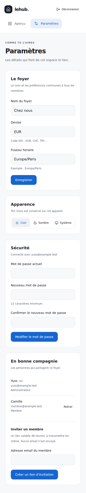
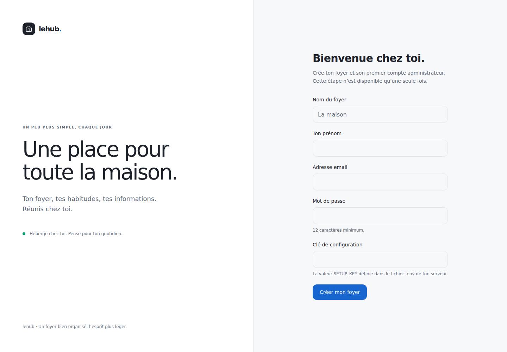

# feat: establish private household foundations

## Objectif

Créer un premier socle utilisable pour lehub : un foyer privé, des comptes sur invitation et une interface française minimaliste, déployable manuellement chez soi.

## Changements

- Next.js App Router, TypeScript strict, Tailwind et composants shadcn/ui personnalisés.
- PostgreSQL/Drizzle : migration initiale versionnée, comptes Better Auth, foyers, appartenances, invitations et limiteur de débit.
- Premier administrateur protégé par une clé serveur ; installation unique sous verrou transactionnel.
- Inscription publique désactivée ; invitations liées à un email, valables 48 h, révocables et à usage unique, jetons stockés sous forme d’empreintes.
- Contrôles de rôle et de foyer côté serveur ; retrait d’un membre, préférences du foyer, modification du mot de passe et déconnexion.
- Aperçu alimenté par les données réelles, états de chargement/erreur, thèmes clair/sombre/système et navigation responsive.
- Dockerfile standalone non-root, Compose manuel, volumes persistants, endpoint santé, documentation Caddy et sauvegarde/restauration.
- Aucun workflow CI/CD, aucune fusion automatique.

## Vérifications exécutées

- `npm run lint` : succès.
- `npm run typecheck` : succès.
- `npm test` : 14 tests d’intégration réussis.
- `npm run build` : succès, sans base ni secrets nécessaires pendant le build.
- `npm audit --omit=dev` : zéro vulnérabilité connue au moment de la vérification.
- `npm run db:generate` : aucun changement non migré.
- `npm run test:e2e` : parcours navigateur réussi sur le serveur standalone avec base éphémère : création initiale, connexion, préférences persistées, invitation et compte membre, refus de réutilisation du lien, permissions d’interface, thèmes, vues 1440 px et 390 px sans débordement ni erreur JavaScript.

## Comment tester

1. Copier `.env.example` vers `.env` et générer trois secrets distincts.
2. `docker compose build`, `docker compose up -d db`.
3. `docker compose --profile tools run --rm migrate`.
4. `docker compose up -d app` puis ouvrir l’URL de `BETTER_AUTH_URL`.
5. Créer le foyer avec `SETUP_KEY`, se connecter, modifier le nom/devise/fuseau.
6. Inviter un membre dans une fenêtre privée, confirmer son accès et l’absence de fonctions administrateur.
7. Révoquer un autre lien ; retirer un membre et vérifier que son accès au foyer est refusé.
8. Vérifier les thèmes, le changement de mot de passe et la déconnexion.

## Migration et variables

Migration initiale : `drizzle/0000_cuddly_wasp.sql`.
Variables : `POSTGRES_USER`, `POSTGRES_DB`, `POSTGRES_PASSWORD`, `DATABASE_URL`, `BETTER_AUTH_URL`, `BETTER_AUTH_SECRET`, `SETUP_KEY`, `DOCUMENTS_DIR`. Voir README pour les différences entre développement local et Compose.

## Limites

- Docker indisponible dans l’environnement de préparation : image et Compose fournis mais non exécutés ici. Le serveur standalone a été testé réellement.
- Tests d’intégration sur PGlite (moteur PostgreSQL), pas de validation des courses multiconnexions sur PostgreSQL natif.
- Un seul foyer actif dans l’interface, pas de promotion/démotion d’administrateurs ni de récupération de mot de passe oubliée.
- Pièces, équipements, maintenance, courses, fichiers privés et export utilisateur appartiennent aux prochains lots. Le volume documents est seulement provisionné.

## Captures

Les captures utilisent des comptes fictifs sur une base éphémère.

